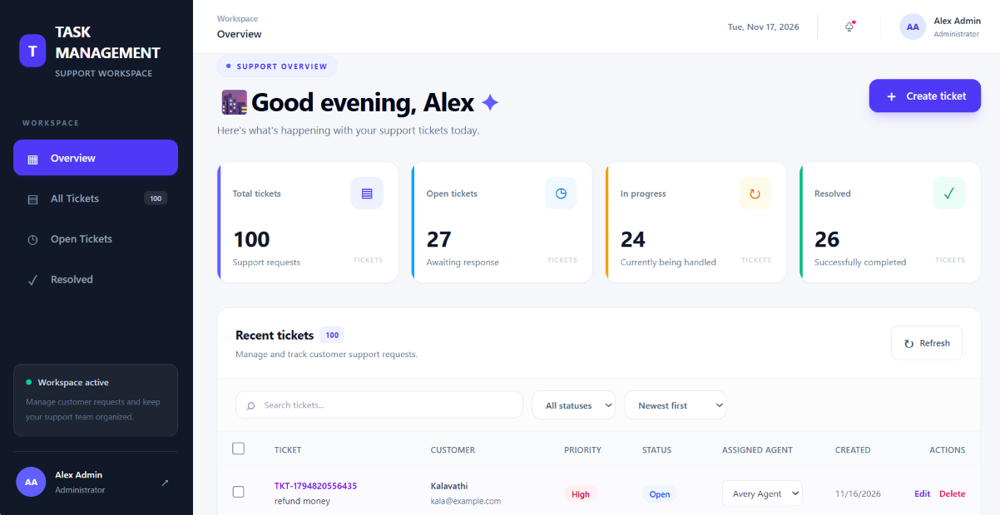
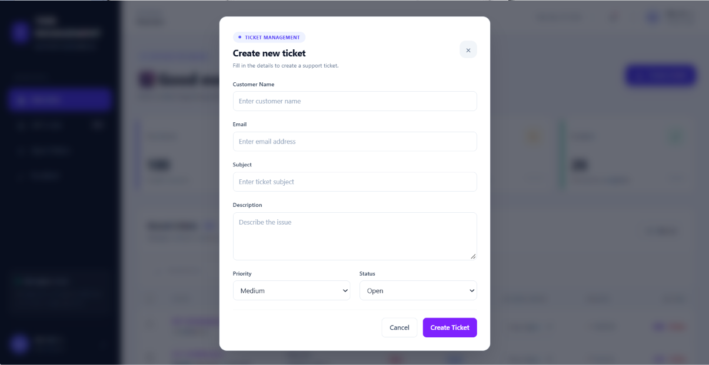
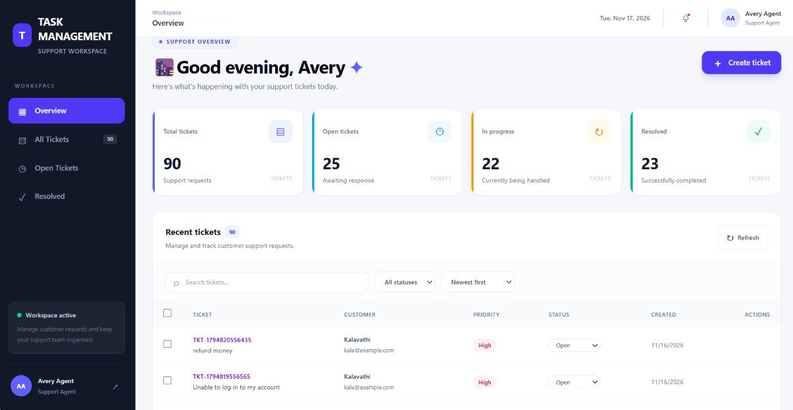
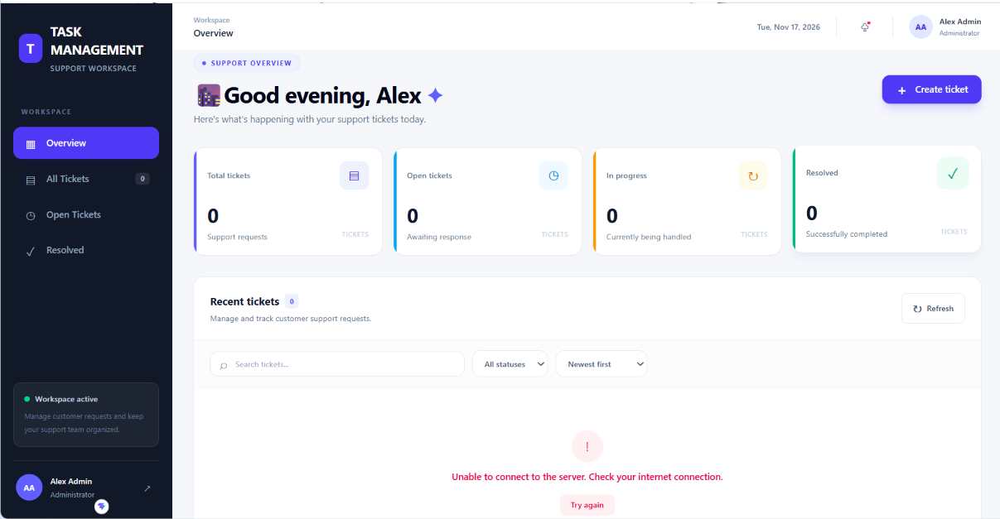

# Task Management – Customer Support Ticket Management Dashboard

[](https://github.com/poorvipoorvikan-art/ticket-management-dashboard/actions/workflows/ci.yml)

A role-based Customer Support Ticket Management Dashboard built using React, TypeScript, Redux Toolkit, and RTK Query.

The application helps support teams manage customer tickets efficiently through role-based access control, ticket operations, search, filtering, sorting, pagination, centralized API error handling, and performance optimization.

## Live Demo

**Live Application:** https://ticket-management-dashboard-gamma.vercel.app

**Backend API:** https://ticket-management-dashboard.onrender.com

## Application Screenshots

### 1. Dashboard Overview



### 2. Ticket Management



### 3. Role-Based Access Control



### 4. API Error Handling



## Features

### Authentication and Authorization

- Mock login functionality.
- Protected dashboard routes.
- Role-based access control.
- Unauthorized access handling.
- Session management using sessionStorage.

### Role-Based Permissions

The application supports three roles:

| Feature | Administrator | Support Manager | Support Agent |
|---|---|---|---|
| View all tickets | Yes | Yes | No |
| View assigned tickets | Yes | Yes | Yes |
| Create tickets | Yes | Yes | Yes |
| Edit tickets | Yes | Yes | No |
| Delete tickets | Yes | No | No |
| Assign tickets | Yes | Yes | No |
| Manage priority | Yes | Yes | No |
| Update ticket status | Yes | Yes | Yes |

Support Agents can view their assigned tickets and update ticket statuses. Tickets created by Support Agents are automatically assigned to them.

### Ticket Management

- Create new support tickets.
- Edit existing tickets.
- Delete tickets based on permissions.
- Assign tickets to support agents.
- Update ticket status and priority.
- Bulk ticket selection and operations.

### Search, Filtering and Pagination

- Search tickets.
- Filter tickets by status.
- Sort ticket records.
- Paginate ticket results.
- Display role-specific ticket data.

### API Reliability and Error Handling

- Centralized API handling using RTK Query.
- Loading, success, empty, and error states.
- Centralized error normalization.
- Automatic retry handling for eligible GET requests.
- Request cancellation and cache management.
- User-friendly API error messages.
- Session handling for unauthorized API responses.

### Monitoring and Logging

- Centralized logging utility.
- Info, warning, error, and debug log levels.
- API request and response monitoring.
- Request duration and failure tracking.
- Sensitive information excluded from logs.
- Debug logging restricted in production.

### Performance Optimization

- Route-based code splitting.
- Lazy loading using React.lazy.
- Suspense-based loading fallbacks.
- Lazy loading of the ticket form.
- Optimized production build.

### Error Boundary

- Application-level React Error Boundary.
- Fallback UI for unexpected rendering errors.
- Recovery option to reload the dashboard.

## Technology Stack

| Category | Technologies |
|---|---|
| Frontend | React, TypeScript |
| Build Tool | Vite |
| State Management | Redux Toolkit |
| API Management | RTK Query |
| Routing | React Router DOM |
| Styling | Tailwind CSS v4 |
| Form Handling | Formik |
| Validation | Yup |
| HTTP Requests | Fetch API |
| Backend | Node.js, Express.js |
| Mock API | JSON Server |
| Testing | Vitest, React Testing Library, MSW |
| Deployment | Vercel, Render |

## Project Structure

```text
ticket-management-dashboard/
│
├── public/
│
├── screenshots/
│   ├── dashboard.png
│   ├── ticket-management.png
│   ├── role-permissions.png
│   └── error-handling.png
│
├── src/
│   ├── app/
│   ├── components/
│   ├── features/
│   ├── hooks/
│   ├── pages/
│   ├── routes/
│   ├── services/
│   ├── utils/
│   ├── types/
│   ├── App.tsx
│   └── main.tsx
│
├── .github/
│   └── workflows/
│       └── ci.yml
│
├── db.json
├── server.cjs
├── package.json
├── vite.config.ts
└── README.md
```

## Installation and Setup

### 1. Clone the Repository

```bash
git clone https://github.com/poorvipoorvikan-art/ticket-management-dashboard.git
```

### 2. Navigate to the Project

```bash
cd ticket-management-dashboard
```

### 3. Install Dependencies

```bash
npm install
```

### 4. Configure Environment Variables

Create a `.env` file in the project root:

```env
VITE_API_URL=http://localhost:3001
```

### 5. Start the Backend

Open a terminal and run:

```bash
npm run server
```

The JSON Server API will run at:

```text
http://localhost:3001
```

### 6. Start the Frontend

Open another terminal and run:

```bash
npm run dev
```

The frontend will run at the local Vite development URL.

## Available Scripts

| Command | Description |
|---|---|
| `npm run dev` | Start the Vite development server |
| `npm run build` | Build the application for production |
| `npm run preview` | Preview the production build |
| `npm run lint` | Run ESLint |
| `npm run server` | Start JSON Server |
| `npm start` | Start the Express server |
| `npm run test` | Run tests in watch mode |
| `npm run test:run` | Run all tests once |
| `npm run test:coverage` | Run tests with coverage |

## Demo Credentials

The application uses mock authentication for demonstration purposes.

Use the demo credentials configured in the application to access the different roles.

**Note:** This project does not implement production-grade backend authentication or real JWT-based authorization.

## Testing

The project uses:

- Vitest
- React Testing Library
- MSW

Test coverage includes:

- Role-based permission utilities.
- Protected routes.
- Ticket components.
- Ticket forms.
- API request handling.
- Error handling.
- Redux ticket operations.

**Latest verified local test result:** 76 tests passed across 11 test files.

Run the tests using:

```bash
npm run test:run
```

## Continuous Integration

GitHub Actions is configured to automatically run the following checks on pushes and pull requests targeting the `main` branch:

1. Checkout the repository.
2. Set up Node.js.
3. Install dependencies.
4. Run the test suite.
5. Build the application.

The CI workflow is available here:

https://github.com/poorvipoorvikan-art/ticket-management-dashboard/actions

## Deployment

- **Frontend:** Vercel
- **Backend:** Render

The frontend communicates with the deployed backend through the `VITE_API_URL` environment variable.

## Security Considerations

- Protected frontend routes.
- Role-based UI permissions.
- Centralized API error handling.
- Sensitive information excluded from application logs.
- Mock authentication clearly separated from production authentication.

**Important:** Frontend permission checks improve the user experience but do not replace backend authorization. Production deployment requires server-side authentication and authorization.

## Future Improvements

- Implement real backend authentication.
- Add JWT access and refresh token handling.
- Implement server-side role-based authorization.
- Add advanced analytics and reporting.
- Improve automated test coverage.
- Integrate a production database.

## Author

**Poorvika**

GitHub: https://github.com/poorvipoorvikan-art